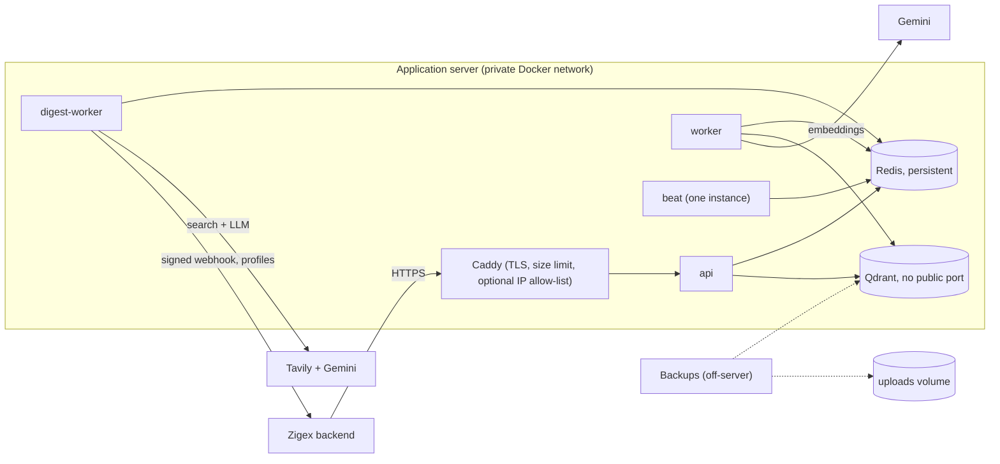

# Zigex AI Services: Documentation

# Part G: Deployment and handoff

This part covers putting the code on GitHub, running it in production, and handing it to the next owner. It ends with an honest list of what is not built yet and a prioritized roadmap.

Files referenced here are delivered with the project:

| File | Purpose |
|---|---|
| `.github/workflows/ci.yml` | Runs the tests and builds the Docker image on every push and pull request |
| `.github/workflows/release.yml` | Publishes the image to GitHub Container Registry when you push a version tag |
| `deploy/docker-compose.prod.yml` | Production override: HTTPS proxy, closed ports, log rotation, memory limits |
| `deploy/Caddyfile` | HTTPS reverse proxy configuration |

---

## 35. Git workflow and GitHub push

### 35.1 What goes in the repository

```
rag-ingest/
├── app/                        code
├── tests/                      automated tests (51)
├── tools/                      eval_retrieval.py, check_weekly_run.py
├── docs/                       these documentation files
├── deploy/                     production override and Caddyfile
├── .github/workflows/          CI and release workflows
├── Dockerfile
├── docker-compose.yml
├── requirements.txt            the short, human-edited list
├── requirements.lock.txt       exact versions (create it in step 36.4)
├── requirements-dev.txt
├── pytest.ini
├── .env.example                template, no real secrets
├── .gitignore
├── .dockerignore
└── README.md
```

**Never committed** (all already in `.gitignore`): `.env`, `doc-env/` or `.venv/`, `__pycache__/`, `uploads/`, `qdrant_local/`.

### 35.2 One-time preparation

1. Create an **empty** repository on GitHub (no README, no `.gitignore`, no licence, since the project already has them).
2. Set your identity once:

```powershell
git config --global user.name "Your Name"
git config --global user.email "you@example.com"
```

### 35.3 First push

From the project folder:

```powershell
git init -b main
git add .
git status
```

**Stop and read the `git status` output.** It must not list `.env`, `doc-env/` or any `uploads/`. It should list `.env.example`. If `.env` appears, fix `.gitignore` before continuing.

Then scan for keys that slipped into files. This finds Google and Tavily key shapes in everything that is about to be committed:

```powershell
git grep --cached -nE "AIza[0-9A-Za-z_-]{20,}|tvly-[0-9A-Za-z_-]{10,}"
```

No output means clean. Any match must be removed first, and the key revoked (35.4).

```powershell
git commit -m "feat: RAG ingestion and weekly opportunity digest"
git remote add origin https://github.com/<org>/<repo>.git
git push -u origin main
```

Authentication: GitHub no longer accepts account passwords for pushes. Use **Git Credential Manager** (it opens a browser sign-in on Windows), a **Personal Access Token** as the password, or an SSH key. Windows warnings such as `LF will be replaced by CRLF` are harmless.

### 35.4 If a secret reached Git

Deleting the file in a later commit does **not** remove it from history, and a public repository is scraped within minutes. Do these in order:

1. **Revoke and replace the key first** (Google AI Studio, the Tavily dashboard, and a new `API_KEY`, webhook secret and profiles token). Everything else is secondary.
2. If the repository only has a few commits, the simplest cleanup is to delete the repository on GitHub, delete the local `.git` folder, and repeat 35.3 with the clean files.
3. For a long history, rewrite it with `git filter-repo` (or BFG Repo-Cleaner), force-push, and ask collaborators to re-clone.

### 35.5 Everyday workflow

| Practice | Rule |
|---|---|
| Branches | `main` is always deployable. Work on short branches such as `feat/ocr-fallback` or `fix/webhook-retry` |
| Pull requests | Every change reaches `main` through a pull request that passes CI |
| Commit messages | Conventional style: `feat:`, `fix:`, `docs:`, `test:`, `chore:` |
| Releases | Tag versions: `git tag v1.0.0` then `git push origin v1.0.0` |
| Never | Commit `.env`, force-push to `main`, or merge with failing CI |

**Protect `main`** on GitHub: Settings, Branches, Add rule for `main`, then tick *Require a pull request before merging* and *Require status checks to pass* (select `test` and `docker` once the first CI run has appeared).

### 35.6 Continuous integration

Copy `.github/workflows/ci.yml` into the repository. On every push to `main` and every pull request it:

1. **`test` job:** installs Python 3.10, installs `requirements.txt` and `requirements-dev.txt`, and runs `pytest -q`. The suite needs no keys, Redis or Qdrant, so **no secrets are added to CI**.
2. **`docker` job** (only if `test` passed): builds the image, which catches a broken `Dockerfile` or a dependency that no longer installs.

Action versions (`checkout@v4`, `setup-python@v5`) were current when written. Check for newer major versions every few months.

### 35.7 Publishing the image (optional)

Copy `.github/workflows/release.yml`. When you push a tag like `v1.0.0`, it builds the image and publishes it to `ghcr.io/<owner>/<repo>` with version tags. A server can then pull a fixed version instead of building. In production Compose, replace `build: .` and `image: rag-ingest:latest` with `image: ghcr.io/<owner>/<repo>:v1.0.0` for `api`, `worker`, `digest-worker` and `beat`.

The first publish may need *Settings, Actions, General, Workflow permissions* set to read and write, and the package set to private or public as you prefer.

### 35.8 Documentation in the repository

Put the documentation files in `docs/` and link them from the root `README.md`. The index file `docs/README.md` lists every part in reading order.

### 35.9 Onboarding a new developer (target: 30 minutes)

| # | Step | Done when |
|---|---|---|
| 1 | Install Docker Desktop and Git | `docker --version` works in a new terminal |
| 2 | `git clone` the repository | The folder contains `docker-compose.yml` |
| 3 | `copy .env.example .env`, fill in `API_KEY`, `GEMINI_API_KEY`, and `MOCK_MODE=true` | `.env` exists and is not tracked |
| 4 | `docker compose build api` | `Image rag-ingest:latest Built` |
| 5 | `docker compose up -d`, then open `/health` and `/docs` | `{"ok": true}` and Swagger loads |
| 6 | Run the smoke test (Part F, 30.5) | All steps pass |
| 7 | Create a venv, `pip install -r requirements-dev.txt`, run `pytest` | 51 passed |
| 8 | Read Parts A, D and E | Can explain the two subsystems and the Zigex contracts |

---

## 36. Production hardening

The delivered stack is correct and tested, but it is configured for development (open ports, a shared key, Swagger visible, Redis as the only store). This section lists what to change before real students depend on it.

### 36.1 Target architecture



### 36.2 Hardening checklist by priority

**P0: before any real student uses it**

| # | Item | Why | How |
|---|---|---|---|
| 1 | HTTPS reverse proxy | Keys and student IDs must not travel in clear text | `deploy/docker-compose.prod.yml` and `deploy/Caddyfile` (36.3) |
| 2 | Close Qdrant and API host ports | Qdrant has no password | The production override removes both. Only Caddy is published |
| 3 | Strong, unique secrets | Defaults are guessable | Part E, 23.1. `API_KEY` must not be `change-me` |
| 4 | `MOCK_MODE=false` and not set in production | Students would receive placeholders | Release gate in Part F, 30.5 |
| 5 | Review mode on | LLM-curated content can contain mistakes | `DIGEST_AUTO_PUBLISH=false` for the first 4 weeks |
| 6 | Log rotation | Logs otherwise fill the disk | Included in the production override |
| 7 | Backups and a tested restore | Data loss | 36.6 |
| 8 | Pinned dependencies and image tags | A new upstream release can break a rebuild | 36.4 |
| 9 | Hide Swagger or protect it | `/docs` reveals the API | Sketch 36.7 (a) |

**P1: within the first month**

| # | Item | Why |
|---|---|---|
| 10 | Per-user tokens (JWT) with department and cohort checks | Today any holder of the shared key can read or delete anything (Part F, 34.4). Sketch 36.7 (d) |
| 11 | Two accepted API keys | Zero-downtime key rotation. Sketch 36.7 (c) |
| 12 | Deep readiness check | `/health` does not test Redis or Qdrant. Sketch 36.7 (b) |
| 13 | Egress rules for `digest-worker` | Second layer against SSRF (Part D, feature note). Block its access to internal ranges except Redis |
| 14 | Uptime and weekly-run alerts | Use `tools/check_weekly_run.py` and an external uptime monitor on `/health` |
| 15 | Virus scanning of uploads | Supervisors upload files that interns' agent will use |
| 16 | Structured logs with `document_id` | Faster debugging |

**P2: as the system grows**

| # | Item | When |
|---|---|---|
| 17 | PostgreSQL for ingestion status, document metadata and digests | When you need history, search, audit trails or reporting. Zigex already keeps digest copies, so Redis loss is survivable |
| 18 | S3 or MinIO for uploads | When workers run on more than one machine |
| 19 | Managed or clustered Qdrant and Redis | When one node is no longer enough or you need high availability |
| 20 | Metrics and dashboards | When you want trends, not just alerts |

### 36.3 Deploying on a single server

**Server preparation (Ubuntu example)**

```bash
# Docker
curl -fsSL https://get.docker.com | sh
sudo usermod -aG docker $USER            # log out and in again

# Firewall: only SSH, HTTP and HTTPS
sudo ufw allow 22/tcp && sudo ufw allow 80/tcp && sudo ufw allow 443/tcp
sudo ufw enable

# Time must be correct (the schedule and webhooks depend on it)
timedatectl status
```

Point a DNS record (for example `ai.example.com`) at the server's IP **before** starting Caddy, so it can obtain a certificate.

**Deploy**

```bash
git clone https://github.com/<org>/<repo>.git && cd <repo>
cp .env.example .env && nano .env        # real secrets, MOCK_MODE=false, DIGEST_AUTO_PUBLISH=false
# edit deploy/Caddyfile: replace ai.example.com with your domain

docker compose -f docker-compose.yml -f deploy/docker-compose.prod.yml up -d --build
docker compose -f docker-compose.yml -f deploy/docker-compose.prod.yml ps
curl -fsS https://ai.example.com/health
```

The override needs **Docker Compose 2.24 or newer** (it uses the `!reset` tag to remove published ports). Check with `docker compose version`. On an older version, delete the `ports:` lines for `api` and `qdrant` in `docker-compose.yml` by hand.

What the override changes:

| Service | Change |
|---|---|
| `api`, `qdrant` | No published host ports. Only Caddy is reachable from outside |
| `caddy` (new) | Terminates HTTPS with an automatic certificate, limits request bodies to 60 MB, proxies to `api:8000` |
| All services | JSON logs rotated at 10 MB, 5 files |
| `api`, `worker`, `digest-worker`, `beat` | Memory limits (1 GB, 1 GB, 1 GB, 256 MB). Adjust after watching `docker stats` |

**Restricting callers.** Caddy can accept requests only from the Zigex backend's public IP. Uncomment the `remote_ip` block in `deploy/Caddyfile` and put the real address in. This is a strong, cheap protection.

> **Shortcut:** from here on, define a shell alias or a `.env` entry `COMPOSE_FILE=docker-compose.yml:deploy/docker-compose.prod.yml` so that a plain `docker compose up -d` always includes the production override.

### 36.4 Pin versions for reproducible builds

Unpinned dependencies mean two builds on different days can differ. Fix this once the stack works.

**1. Create the lock file from inside the Linux image.** Do not run `pip freeze` on Windows: it lists Windows-only packages that break the Linux build (the cause of the oversized build earlier).

```powershell
docker compose run --rm -T api pip freeze | Out-File -Encoding ascii requirements.lock.txt
```

The `-Encoding ascii` matters. Windows PowerShell's default `>` writes UTF-16, which pip cannot read. On Linux or macOS, `docker compose run --rm -T api pip freeze > requirements.lock.txt` is fine.

**2. Use it in the `Dockerfile`:**

```dockerfile
COPY requirements.lock.txt .
RUN pip install --no-cache-dir --default-timeout=300 --retries 10 -r requirements.lock.txt
```

**3. Pin the third-party images** in `docker-compose.yml`, using the versions you tested (the Qdrant and Redis versions are printed in their startup logs):

```yaml
  qdrant:
    image: qdrant/qdrant:v1.19.2
  redis:
    image: redis:7.4-alpine
```

**4. Keep `requirements.txt` as the human-edited list.** To upgrade, change it, rebuild, run `pytest` and the smoke test, then regenerate the lock file.

### 36.5 Updating and rolling back

**Update**

```bash
git pull
docker compose -f docker-compose.yml -f deploy/docker-compose.prod.yml up -d --build
```

Data lives in volumes, so code updates do not touch vectors, queues or uploads.

**Roll back**

```bash
git checkout v1.0.0        # the last good tag
docker compose -f docker-compose.yml -f deploy/docker-compose.prod.yml up -d --build
```

There is a short interruption while containers restart (no zero-downtime deploy). Do updates outside Monday 06:00 to 08:00, when the weekly run is in progress. If a job is interrupted, Celery re-delivers it (`acks_late` is on), and ingestion and digest tasks are safe to repeat.

**After changing the embedding model or dimension:** follow Part C, 13.4. That is a re-index, not an update.

### 36.6 Backups (template)

> **Untested template.** Test the backup and the restore on a copy before relying on them.

What matters, in order:

| Data | Importance | Why |
|---|---|---|
| `uploads` volume (original course files) | **Highest** | Everything in Qdrant can be rebuilt from these by re-uploading |
| Qdrant snapshot | High | Avoids hours of re-embedding and rate-limit waits |
| Redis volume | Medium | Digests are also stored in the Zigex database by the webhook. Redis loss means losing the 120-day history and "already sent" lists, not students' access |
| `.env` | High | Store it in a password manager, not in a backup folder |

```bash
#!/usr/bin/env bash
# /opt/backup-ai.sh  (run daily from cron: 0 3 * * * /opt/backup-ai.sh)
set -euo pipefail
cd /srv/<repo>
export COMPOSE_FILE=docker-compose.yml:deploy/docker-compose.prod.yml
PROJECT=$(basename "$PWD")                         # volume names start with this
DEST=/backups/$(date +%F); mkdir -p "$DEST"

# 1. Qdrant snapshot, then copy it out
docker compose exec -T api python -c \
  "from app.core.vectorstore import client; print(client.create_snapshot('course_content'))"
docker compose cp qdrant:/qdrant/storage/snapshots "$DEST/qdrant-snapshots"

# 2. Uploads and Redis volumes
for v in uploads redisdata; do
  docker run --rm -v ${PROJECT}_${v}:/data -v "$DEST":/backup alpine \
    tar czf /backup/${v}.tgz -C /data .
done

# 3. Keep 14 days
find /backups -maxdepth 1 -type d -mtime +14 -exec rm -rf {} +
```

Copy `/backups` to a different machine or object storage. A backup on the same disk does not survive a disk failure. **Restore test:** on a spare machine, start the stack, restore the volumes, and run the smoke test.

### 36.7 Code sketches for the hardening items

> These are **designs, not delivered code.** They are short on purpose. Implement each with tests.

**(a) Hide Swagger in production**

```python
# config.py
enable_docs: bool = True
# main.py
app = FastAPI(title="...", lifespan=lifespan,
              docs_url="/docs" if settings.enable_docs else None,
              redoc_url=None,
              openapi_url="/openapi.json" if settings.enable_docs else None)
```

Set `ENABLE_DOCS=false` in production. Staff can use `curl` or Postman against the API.

**(b) Deep readiness check**

```python
from fastapi.responses import JSONResponse
from app.core.status import r

@app.get("/health/ready")
def ready():
    checks = {}
    try: r.ping(); checks["redis"] = "ok"
    except Exception as e: checks["redis"] = f"error: {e}"
    try: vectorstore.client.get_collections(); checks["qdrant"] = "ok"
    except Exception as e: checks["qdrant"] = f"error: {e}"
    ok = all(v == "ok" for v in checks.values())
    return JSONResponse(checks, status_code=200 if ok else 503)
```

Point the uptime monitor at `/health/ready`. It deliberately does not call Gemini or Tavily, so it does not spend quota.

**(c) Two API keys, and a safer comparison**

```python
# config.py
api_keys: str = ""        # extra keys, comma-separated (the old and the new during rotation)

# security.py
import hmac
def require_api_key(key: str | None = Security(api_key_header)):
    valid = [settings.api_key] + [k for k in settings.api_keys.split(",") if k]
    if not key or not any(hmac.compare_digest(key, v) for v in valid):
        raise HTTPException(401, "Invalid API key")
```

Rotation becomes: add the new key to `API_KEYS`, redeploy, switch Zigex to the new key, then make it the main `API_KEY` and clear `API_KEYS`. No `401` window. (`hmac.compare_digest` also replaces the current `!=`, which is not constant-time.)

**(d) Per-user JWT with ownership checks**

Zigex issues a short-lived signed token for each call (`sub`, `role`, `department`, `cohort_ids`, `exp`, audience `zigex-ai`). The AI service verifies the signature with Zigex's public key and enforces the claims:

```python
import jwt   # PyJWT: add to requirements.txt

def require_user(authorization: str = Header(...)):
    token = authorization.removeprefix("Bearer ")
    try:
        return jwt.decode(token, settings.jwt_public_key, algorithms=["RS256"],
                          audience="zigex-ai", issuer="zigex")
    except jwt.PyJWTError:
        raise HTTPException(401, "Invalid token")

# upload:  claims["role"] == "supervisor" and department == claims["department"]
#          and cohort_id in claims["cohort_ids"]
# search:  department == claims["department"] and cohort_id in claims["cohort_ids"]
# delete:  the document's stored department and cohort must match the claims
```

This also removes the "any caller can overwrite any document by ID" weakness, because ownership is checked against the token, not just the shared key. Keep the shared key for the server-to-server digest and webhook endpoints.

---

## 37. Known limitations and roadmap

### 37.1 Known limitations

Everything below is true of the delivered code. Each one is also noted in the part where it matters.

| # | Limitation | Effect | Documented in |
|---|---|---|---|
| L1 | One shared API key, no per-user authorization | Any caller with the key can read, replace or delete any document and read any digest | Part F, 34.4 |
| L2 | No overlapping keys | Rotating `API_KEY` causes a short window of `401` | Part E, 23.3 |
| L3 | `DELETE /v1/documents/{id}` leaves the Redis status record | Harmless clutter | Part C, 11.7 |
| L4 | No OCR. Tables in DOCX, and table cells and speaker notes in PPTX, are not extracted | Scanned PDFs fail. Some content is not searchable | Part C, 11.8 |
| L5 | No ingestion-complete event | Zigex must poll for document status | Part E, 27.1 |
| L6 | A `dry_run` overwrites a real digest of the same week | Test with `/preview` during a live week | Part D, 20.5 |
| L7 | A `pending_review` or `dry_run` digest hides the previous published digest from `GET /student/{id}` | Students see "no digest" until the new one is approved | Part D, 20.5 |
| L8 | No per-segment re-run | A forced run redoes every segment and re-sends published ones | Part D, 19.7 |
| L9 | No unpublish endpoint and no domain blocklist | A bad digest must be removed by hand | Part F, 34.9 |
| L10 | Opportunities with no dates are kept | A stale listing can slip through | Part D, 18.1 |
| L11 | Students who join after Monday's run have no digest until the next run | 404 for up to a week | Part E, 26.3 |
| L12 | Images belong to third parties and are hotlinked. Some pages have none | Rights questions, broken images, 60 to 90 percent coverage | Feature note on page images |
| L13 | Digests are written in English only | Cameroon is bilingual (French and English) | this section |
| L14 | `/health` does not check dependencies | A green check can hide a dead Qdrant | Part F, 31.3 |
| L15 | Digests, status and "already sent" lists live only in Redis | No query history or audit. Loss of the volume loses the 120-day history | Part D, 20.1 |
| L16 | A missed Beat run is not replayed | If `beat` is down on Monday 06:00, nothing runs | Part D, 19.5 |
| L17 | Webhook has no timestamp | A captured request could be replayed. Idempotent storage limits the damage | Part E, 25 |
| L18 | Retrieval is dense-vector only, with no reranker | Exact terms (error codes, names) can be missed | Part C |
| L19 | Gemini and Tavily free tiers are rate-limited, and free-tier text may be used by Google | Slow ingestion, daily caps, confidentiality | Part C, 13.3 and 13.6 |
| L20 | No structured logs or metrics | Debugging relies on `docker compose logs` | Part F, 31.9 |

### 37.2 Roadmap

Effort: **S** is up to 1 day, **M** is 2 to 5 days, **L** is more than a week.

**Phase 1: hardening (weeks 1 to 4)**

| ID | Item | Fixes | Effort |
|---|---|---|---|
| R1 | Production deployment, CI, pinned dependencies, backups (this Part) | P0 list | S to M |
| R2 | Digest integrity fixes (37.3, item 1) | L6, L7, L8, L9, L10 | M |
| R3 | Key rotation with two keys, readiness endpoint, hide Swagger (36.7 a to c) | L2, L14 | S |
| R4 | Per-user JWT authorization (36.7 d) | L1 | M |
| R5 | Ingestion-complete webhook to Zigex | L5 | S |
| R6 | Zigex "refresh one student" call so new students get a digest | L11 | S |

**Phase 2: quality (weeks 4 to 10)**

| ID | Item | Fixes | Effort |
|---|---|---|---|
| R7 | Hybrid search plus reranking (37.3, item 2) | L18 | M |
| R8 | OCR fallback for scanned PDFs, table extraction for DOCX and PPTX | L4 | M |
| R9 | Bilingual digests, based on a student language preference | L13 | M |
| R10 | PostgreSQL for status, documents and digests | L15 | L |
| R11 | Re-index tool (rebuild the collection under a new model or chunk size) | Part C, 13.4 | M |
| R12 | Retrieval evaluation run in CI against a fixed question set | Regression safety | S |

**Phase 3: product (after that)**

| ID | Item | Value | Effort |
|---|---|---|---|
| R13 | Zigex-native events inside the digest (37.3, item 3) | The original goal: events published on Zigex reach all 700+ students | M |
| R14 | Per-student picks inside a segment digest (37.3, item 4) | More relevant than segment-wide lists | M |
| R15 | Email and push delivery of the digest | Reach | M |
| R16 | Click and open analytics (tracked redirect links) | See which opportunities students use | M |
| R17 | Review interface for staff (approve, edit, reject) | Replaces calling `publish` by hand | L |
| R18 | Structured logging and metrics (Prometheus or similar) | L20 | M |

### 37.3 Design notes for the main items

**1. Digest integrity fixes (R2)**

| Problem | Fix |
|---|---|
| Dry runs overwrite real digests (L6) | Store dry runs under `digest_dry:<week>:<segment>`, or refuse a dry run when a published digest already exists |
| Unapproved digest hides the last published one (L7) | Keep a separate `digest_published:<segment>` pointer, updated only on publish. `GET /student/{id}` reads that pointer |
| No per-segment re-run (L8) | Save each segment's attributes at run time (`segment:<id>` as JSON). Add `POST /v1/digests/{week}/{segment}/rerun` that rebuilds one segment from them |
| No unpublish (L9) | Add `POST .../unpublish`, status `withdrawn`, and a new webhook event `digest_withdrawn` so Zigex hides it. Add a domain blocklist setting applied before curation |
| Undated items (L10) | Mark them `date_unknown` and render "check the date on the official page", or add `DIGEST_REQUIRE_DATE=true` to drop them |

**2. Hybrid search and reranking (R7)**

1. Add a sparse (keyword) vector next to the dense one in the Qdrant collection, so exact terms match.
2. Run both searches and merge the lists with reciprocal rank fusion.
3. Rerank the top 20 with a cross-encoder (for example a BGE reranker) or an LLM call, and return the top 5.
4. Judge it with `tools/eval_retrieval.py` before and after. Keep it only if `hit@5` and MRR improve.

**3. Zigex events inside the digest (R13)**

Zigex already knows about events companies publish. Add a third source next to web search: the service fetches upcoming events from a Zigex endpoint (same contract style as the profiles endpoint), filters by department and location, and gives them the same item format with `source: "zigex"`. Put them **first** in the digest. They need no web search, no validation of links, and they are the most trustworthy items.

**4. Per-student picks (R14)**

After a segment digest is built, embed each item (about 6 per segment) and each student's skills and interests text, rank by cosine similarity, and send each student their top 3 as `student_picks` in the webhook. This is about 700 small embedding calls a week. Only skills and interests text is sent for embedding, never names. Keep the segment digest as the fallback.

### 37.4 Extension points

| To add or change | Where | Notes |
|---|---|---|
| A new document type | `app/core/parsers.py` (new branch) and the `ALLOWED` set in `app/api/documents.py` | Return `(sections, kind)`. Add a test with a small fixture file |
| A new department | `ALLOWED_DEPARTMENTS` in `.env` | Also add it to the Zigex mapping (Part E, 27.1) |
| A new embedding provider | `app/core/embedder.py`: `embed_documents`, `embed_query` | Update `EMBEDDING_DIM`, recreate the collection, re-upload (Part C, 13.5) |
| A new web search provider | `app/core/tavily_search.py`: keep the `search_web` return shape | Results as `{url, title, content, score}`, images as `{url, description}` |
| A different LLM | `app/core/llm.py`: `generate_json` | Must return a parsed JSON object |
| A new delivery channel | `app/core/delivery.py` | Call it from `digest_tasks.py` after the webhook |
| Digest wording and rules | The two prompts in `app/core/digest_agent.py` (`PLAN_QUERIES`, `CURATE_DIGEST`) | Re-run the digest tests and preview a few segments |
| Schedule | `DIGEST_CRON_DAY`, `DIGEST_CRON_HOUR`, `DIGEST_TIMEZONE` | Restart `beat` |

Always add or update a test when you change behaviour, and keep CI green.

### 37.5 Handoff summary

**What the next owner receives**

- The repository, with 51 passing tests and CI
- This documentation (Parts A to G, the page-images note, and the appendices)
- The Docker setup for development and the production override
- The tools for evaluating retrieval and checking the weekly run

**What they must do in week one**

1. Complete the onboarding in 35.9.
2. Deploy to a test server with the production override and run the smoke test.
3. Create the real secrets and the lock file (36.4).
4. Connect the Zigex backend (Part E, steps 1 to 9) and rehearse a digest in review mode.
5. Set up backups and the Monday check (31.5, 36.6).
6. Choose the first roadmap items. Recommended order: R2, R3, R5, R4.

**Decisions the owner must make with Zigex**

| Question | Why it matters |
|---|---|
| Show third-party images, or link cards only? | Image rights |
| How long to stay in review mode? | Quality against workload |
| Which languages will digests need? | R9 |
| Which data-protection rules apply to student profiles? | Retention and deletion (Part F, 34.5 and 34.6) |
| Does Zigex want Zigex-native events in the digest? | R13 |

---

## Part G checklist

You have completed Part G when:

- [ ] The repository is on GitHub, with no `.env` and no keys in history
- [ ] CI runs on pull requests and `main` is protected
- [ ] The stack runs on a server with HTTPS, and Qdrant and the API are not directly reachable
- [ ] `requirements.lock.txt` exists and the `Dockerfile` uses it, and Qdrant and Redis image tags are pinned
- [ ] A backup has run, and a restore has been tested on a spare machine
- [ ] A new developer completed the onboarding (35.9) in about 30 minutes
- [ ] The owner has read the limitations list (37.1) and chosen the first roadmap items

**Next: the appendices** (full API reference, Redis key reference, copy-paste cURL and Postman collection, and the file listing).
